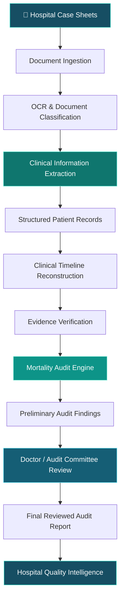
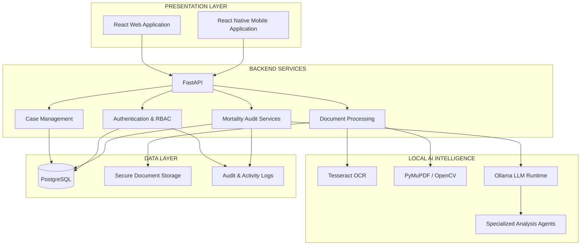

 <div align="center">


<br/>


<br/>

<a href="#"></a>


<br/><br/>

**An AI-powered mortality audit and hospital quality intelligence platform.**

*Transforming large, fragmented hospital case sheets into structured clinical timelines, explainable audit findings and evidence-linked insights.*

<br/>

</div>

---

## ◈ The Vision

Hospitals generate enormous amounts of clinical documentation throughout a patient's hospital journey. Reviewing hundreds of pages manually to reconstruct events, identify documentation gaps and prepare mortality audit reports can be a complex process.

**MedAudit AI** is designed to bring intelligence, structure and traceability to this process.

Rather than simply summarizing patient records, the platform is being developed to understand the sequence of clinical events, correlate information across departments and support mortality audit committees with evidence-linked analysis.

<div align="center">


### From documents to decisions — with evidence at every step.

</div>

## ◈ The Three Intelligence Engines

<table>
<tr>
<td width="33%" align="center">


### Case Intelligence


Extracts and organizes clinical information from complex patient records.

- PDF and ZIP ingestion
- OCR and document classification
- Clinical entity extraction
- Vitals and laboratory data
- Medication records
- Source-page references

</td>
<td width="33%" align="center">


### Mortality Audit


Connects extracted information into a structured clinical audit workflow.

- Clinical timeline reconstruction
- Deterioration identification
- Evidence verification
- Documentation gap analysis
- Preliminary audit findings
- Human-reviewed assessment

</td>
<td width="33%" align="center">


### Quality Intelligence


Transforms approved audit outcomes into hospital-level quality insights.

- Recurring audit patterns
- Department-level trends
- Quality analytics
- Corrective-action tracking
- Cross-case intelligence

</td>
</tr>
</table>

## ◈ How MedAudit AI Works

<div align="center">



</div>

## ◈ Core Platform Capabilities

<table>
<tr>
<td width="50%">

### 🗂️ Document Intelligence

- Multi-page PDF processing
- Batch document ingestion
- OCR-based extraction
- Page classification
- Structured clinical records
- Evidence provenance

</td>
<td width="50%">

### 🫀 Clinical Timeline

- Chronological event reconstruction
- Patient observation tracking
- Physician and nursing note correlation
- Clinical deterioration tracking
- Timestamp discrepancy detection
- Event-level evidence references

</td>
</tr>
<tr>
<td width="50%">

### 📊 Clinical Analytics

- Vital-sign trends
- Laboratory trends
- Medication history
- Fluid balance analysis
- Organ-support documentation
- Investigation summaries

</td>
<td width="50%">

### 🔍 Explainable Mortality Audit

- Medical care review
- Nursing documentation review
- Escalation and handover review
- Documentation quality assessment
- Evidence-linked findings
- Human-in-the-loop assessment

</td>
</tr>
<tr>
<td width="50%">

### 🏥 Hospital Quality Intelligence

- Cross-case patterns
- Department-level analytics
- Recurrent documentation gaps
- Audit outcome tracking
- Corrective actions

</td>
<td width="50%">

### 🔐 Security and Privacy

- Role-based access control
- Doctor-specific workspaces
- Administrative account management
- Secure authentication
- Local AI inference architecture
- Controlled access to patient records

</td>
</tr>
</table>

## ◈ System Architecture

<div align="center">



</div>

## ◈ Technology Stack

<div align="center">

**Frontend**


**Backend & Database**


**AI & Document Processing**


</div>

| Layer | Technologies |
|---|---|
| Web frontend | React, Vite, JavaScript |
| UI | Tailwind CSS, Framer Motion, Lucide React |
| Mobile | React Native, Expo |
| Backend | Python, FastAPI |
| Database | PostgreSQL, SQLAlchemy |
| Migrations | Alembic |
| AI runtime | Ollama |
| OCR | Tesseract |
| Document processing | PyMuPDF, OpenCV, Pillow |
| Data processing | Pandas, NumPy |
| Testing | Pytest |

*Technology choices describe the intended MedAudit AI 2.0 architecture. Update this table as the implementation evolves.*

## ◈ The Evidence-First Approach

MedAudit AI is designed around a fundamental principle:

<div align="center">


</div>

Every generated audit finding should be traceable to its source.

| Information Type | Expected Handling |
|---|---|
| Explicitly documented | Extract and preserve |
| Interpreted information | Clearly label as interpreted |
| Missing information | Report as missing |
| Conflicting information | Flag for verification |
| Uncertain extraction | Mark for human review |
| Audit conclusion | Subject to qualified review |

The platform is intended to support clinical audit committees, not independently make final preventability decisions.

## ◈ Development Roadmap

- [ ] Secure authentication and administrator portal
- [ ] Doctor-specific private workspaces
- [ ] Patient and case management
- [ ] Secure PDF and ZIP ingestion
- [ ] OCR and page classification
- [ ] Structured clinical data extraction
- [ ] Clinical timeline reconstruction
- [ ] Multi-agent audit orchestration
- [ ] Evidence-linked audit findings
- [ ] Preventability review workflow
- [ ] Hospital quality analytics
- [ ] React Native mobile application
- [ ] Automated evaluation using synthetic case files

## ◈ Repository Setup

Clone the repository:

```bash
git clone https://github.com/SamPunithaRajD/REPOSITORY_NAME.git

cd REPOSITORY_NAME
```

Replace `REPOSITORY_NAME` with the actual GitHub repository name.

Refer to the project documentation and `.env.example` for the current installation, environment and service setup instructions.

## ◈ Privacy, Safety and Clinical Responsibility

MedAudit AI is being designed as a clinical audit decision-support system.

- Patient records must be protected through server-side access controls.
- Doctor workspaces must remain isolated unless access is explicitly authorized.
- Uploaded documents must be treated as untrusted input.
- Local AI execution is intended to avoid sending patient records to external AI APIs by default.
- Generated findings must retain evidence provenance.
- AI-generated findings require human verification.
- Preventability must not be represented as a validated probability without appropriate clinical validation.
- The project does not claim regulatory certification or replace professional medical judgment.

**All demonstration and test records must be synthetic.**

## ◈ Project Preview

<div align="center">

<!-- Replace this section with actual screenshots or a demo GIF from the application -->


<br/>

<sub>Replace this placeholder with a screenshot or animated recording of the actual application.</sub>

</div>

## ◈ About the Project

**MedAudit AI 2.0** is an evolving healthcare AI project focused on intelligent mortality audit, structured clinical documentation analysis and hospital quality intelligence.

The goal is to reduce the burden of manually navigating complex medical records while making audit reviews more organized, explainable and evidence-driven.

<div align="center">


### BUILT TO CONNECT CLINICAL RECORDS WITH CLINICAL INTELLIGENCE.

<br/>


<br/><br/>

**MEDAUDIT AI · 2.0**

<sub>Clinical Intelligence. Evidence. Accountability.</sub>

</div>
